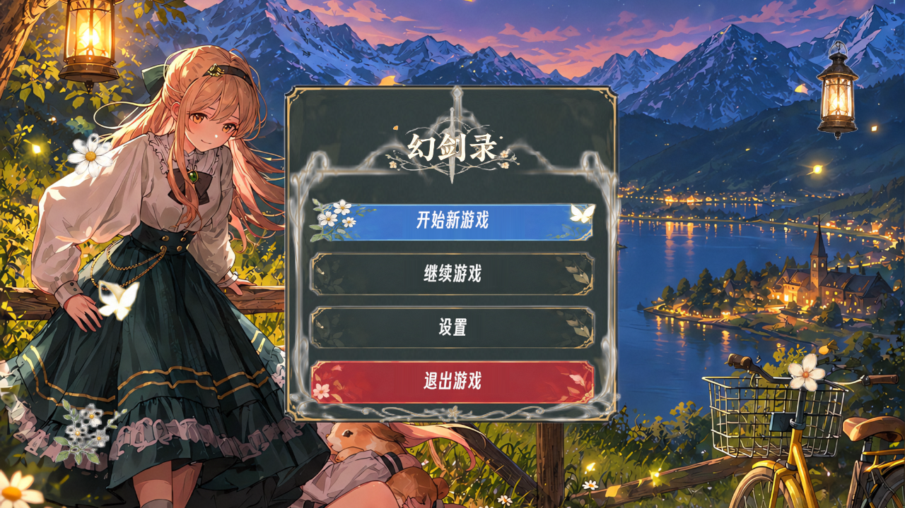
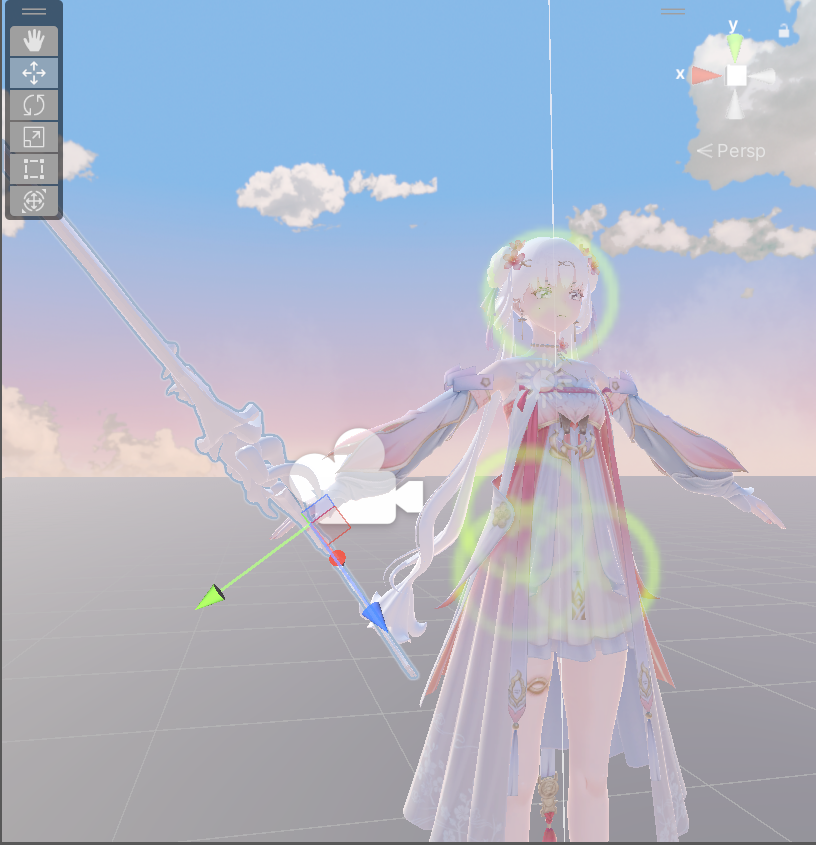
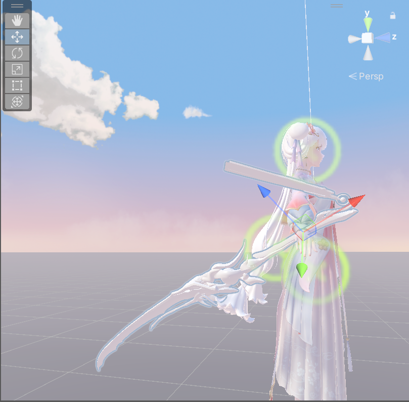

# 幻剑录（HuanJianLu）· 3D 动作 RPG Demo

> 独立开发的第三人称动作 RPG Demo，覆盖战斗、技能、装备、背包、任务、商店、对话、副本与存档等核心玩法闭环。
> 使用 Unity 2022.3 LTS + C# 开发，本仓库为本人编写的游戏客户端脚本（136 个 C# 文件）。

## 演示视频

<!-- TODO: 上传视频后，把下面的“待补充”替换成视频链接 -->
- 演示视频：bilibili.com/video/BV1RmJi6yE4S（B 站 / YouTube 链接）**

## 项目截图

| 主菜单 | 战斗场景 |
| --- | --- |
|  |  |



## 技术栈

- **引擎**：Unity 2022.3 LTS、Universal Render Pipeline（URP）
- **语言**：C#
- **输入**：Unity Input System
- **动画**：Animator + Animation Event 驱动攻击判定
- **UI**：UGUI 分层面板栈（HUD / 背包 / 技能 / 任务 / 设置等）
- **AI**：NavMesh 寻路 + 有限状态机
- **热更新**：HybridCLR + YooAsset
- **对话**：Yarn Spinner
- **存档**：JsonUtility 分系统存读档

## 核心功能

| 模块 | 实现要点 | 主要代码 |
| --- | --- | --- |
| 战斗系统 | 4 段连招、蓄力重击、弹反、跑攻；Animation Event 驱动命中帧；顿帧 + 相机震动强化打击感 | [Combat](Assets/MyAssets/Scripts/Combat) |
| 技能系统 | Q/E/R/F 技能槽、冷却与能量消耗、技能升级、技能特效 | [SkillSystem.cs](Assets/MyAssets/Scripts/Combat/Player/SkillSystem.cs) |
| 武器与装备 | 双武器切换、装备穿戴、属性加成 | [WeaponSystem.cs](Assets/MyAssets/Scripts/Combat/Player/WeaponSystem.cs)、[EquipmentSystem.cs](Assets/MyAssets/Scripts/Equipment/EquipmentSystem.cs) |
| 敌人 AI | 巡逻 / 追击 / 攻击 / 死亡状态机，掉落系统与波次刷怪 | [EnemyAI.cs](Assets/MyAssets/Scripts/Combat/Enemy/EnemyAI.cs) |
| 背包系统 | 物品拾取、堆叠、使用、装备与任务奖励接入 | [InventoryManager.cs](Assets/MyAssets/Scripts/Inventory/InventoryManager.cs) |
| 任务系统 | 任务接取、目标追踪、奖励发放、任务日志 | [QuestManager.cs](Assets/MyAssets/Scripts/Quest/Runtime/QuestManager.cs) |
| 对话与引导 | Yarn Spinner 对话、新手引导流程、商店对话桥接 | [Dialogue](Assets/MyAssets/Scripts/Dialogue) |
| 副本系统 | 秘境传送、波次战斗、结算发奖 | [DungeonManager.cs](Assets/MyAssets/Scripts/Dungeon/DungeonManager.cs) |
| UI 框架 | 持久层 + 弹窗栈，打开面板自动暂停游戏并解锁鼠标 | [UGUIManager.cs](Assets/MyAssets/Scripts/UI/UGUI/UGUIManager.cs) |
| 存档系统 | 任务 / 背包 / 装备 / 等级分系统存档与读档 | [SaveManager.cs](Assets/MyAssets/Scripts/Save/SaveManager.cs) |
| 性能优化 | 对象池、Animator 剔除、URP 画质与帧率调优、Profiler 定位瓶颈 | [Core](Assets/MyAssets/Scripts/Core) |
| 热更新 | HybridCLR 脚本热更 + YooAsset 资源热更 | [HotUpdateRuntime.cs](Assets/MyAssets/Scripts/Boot/HotUpdateRuntime.cs) |

## 目录结构

```
Assets/MyAssets/Scripts
├── Audio/          # 音频管理与战斗音效反馈
├── Boot/           # 游戏入口、配置、热更新启动
├── Character/      # 角色控制
├── Combat/         # 战斗、技能、敌人 AI、掉落
├── Core/           # 对象池、性能优化
├── Dialogue/       # Yarn Spinner 对话
├── Dungeon/        # 副本流程
├── Equipment/      # 装备系统
├── Guide/          # 新手引导
├── Interaction/    # 拾取与交互
├── Inventory/      # 背包与物品
├── Quest/          # 任务系统
├── Save/           # 存档系统
├── Shop/           # 商店系统
└── UI/             # UGUI 面板与 HUD
```

## 说明

- 本仓库仅包含**本人编写的 C# 脚本**与项目截图，方便直接阅读代码。
- 第三方付费美术资源（模型、动画、场景、音频）、AssetBundle、构建产物未上传，因此仓库不能直接运行。
- 如需查看完整运行效果，请观看上方演示视频。

## 联系方式

- 邮箱：3328643750@qq.com
